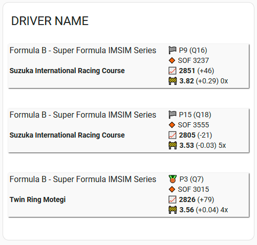

# iRacing integration for Home Assistant

## ⚠ BREAKING CHANGE since iRacing 2026S1

The legacy authentification is now removed in iRacing. See more information here: https://forums.iracing.com/discussion/84226/legacy-authentication-removal-dec-9-2025/p1

To use this integration, you must request to the iRacing staff a **client ID** and **client secret**. Currently, the request must be sent by mail as described here: https://oauth.iracing.com/oauth2/book/password_limited_flow.html

In you request, you can mention that you need the credentials to run a the Home Assistant integration for your own usage.

Note that even with the password_limited flow, the iRacing OAuth authentication still requires your iRacing credentials.

## Installation

### Using HACS

Add this repository to HACS, then:  
HACS > Integrations > **iRacing**

### Manual install

Copy the `iracing` folder from latest release to the `custom_components` folder in your `config` folder.

## Configuration

Go to :  
Settings > Devices & Sevices > Integrations > Add Integration, and search for "Iracing"

You can add as many drivers as you want.

For the first driver, you are required to enter:

- Your iRacing login (email address)
- Your iRacing password
- Your client ID (obtained from iRacing staff, see above)
- Your client secret (obtained from iRacing staff, see above)
- The _customer ID_ of the driver to monitor

For the subsequent drivers, you are only required to enter the _customer ID_.

## Note about iRacing credentials

The iRacing credentials are required to access the official iRacing API. Using this API is totally validated by iRacing, and it is safe to use your credentials for that.
For more information see https://forums.iracing.com/discussion/15068/general-availability-of-data-api/p1.

Your credentials are only stored locally on your Home Assistant. They are not used for anything else than API authentication. In case of doubt, you can review the source code.

## Sensors

| Sensor                               | Description                                            |
| ------------------------------------ | ------------------------------------------------------ |
| `sensor.DRIVER_NAME_driver`          | Driver name + attributes which give the 5 last results |
| `sensor.DRIVER_NAME_CATEGORY_ir`     | iRating on the category                                |
| `sensor.DRIVER_NAME_CATEGORY_sr`     | Safety rating on the category                          |
| `sensor.DRIVER_NAME_CATEGORY_laps`   | Total laps completed in the career for the category    |
| `sensor.DRIVER_NAME_CATEGORY_starts` | Total race starts in the career for the category       |
| `sensor.DRIVER_NAME_CATEGORY_wins`   | Total wins in the career for the category              |
| `sensor.DRIVER_NAME_CATEGORY_top5`   | Total top 5 finishes in the career for the category    |

The `CATEGORY` can be: `sports_car`, `formula_car`, `dirt_road`, `oval`, `dirt_oval`

## Displaying race results

You can use the [iracing-result-card](https://github.com/cazeaux/iracing-result-card).

